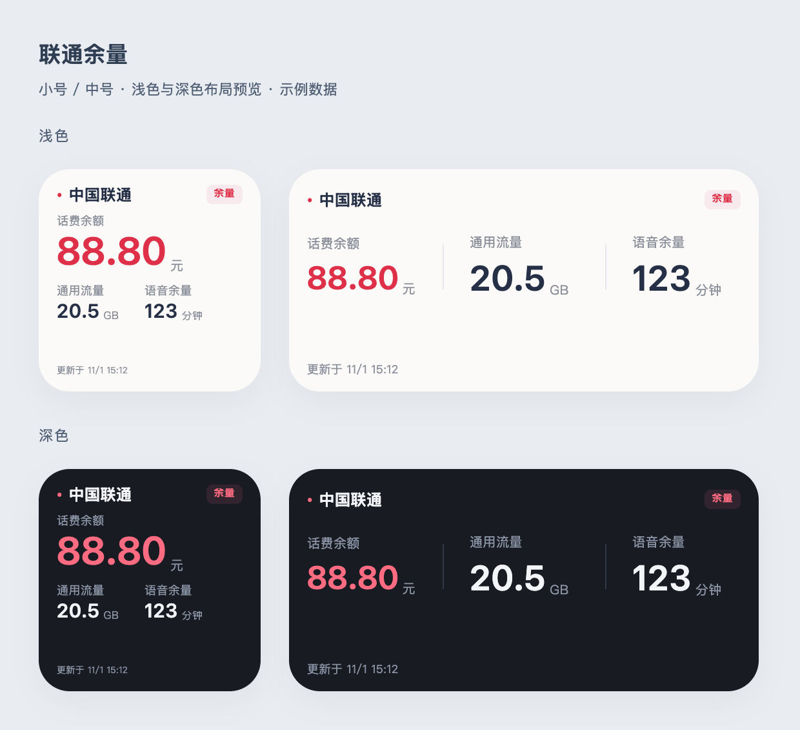

# Scriptable—script

clxiso 的 Scriptable 脚本集合。

## 联通余量

显示话费余额、剩余通用流量与语音余量。支持小号、中号桌面组件，自动适配浅色和深色外观。

> 图片由脚本布局生成，使用示例数据，仅用于说明设计，不是 iPhone 实机截图。

### 下载和安装

[下载联通余量.js](https://raw.githubusercontent.com/1clxiso/Scriptable-script/main/%E8%81%94%E9%80%9A%E4%BD%99%E9%87%8F.js)

1. 将脚本导入 Scriptable，或新建脚本并粘贴代码，名称保持为 **联通余量**。
2. 在配套 Loon「中国联通去广告自用版」中开启「获取联通余量 Cookie」，打开已登录的联通 App 刷新首页。
3. 点击 Loon 的获取成功通知，在 Scriptable 中看到「导入成功」后，可关闭获取开关。
4. 桌面添加 Scriptable 小号或中号组件，选择「联通余量」，组件参数留空。

更新脚本时替换现有代码，保留脚本名称。凭据、组件设置和余量缓存保存在本机 Keychain，替换代码无需重新录入。

### 组件设置

直接运行脚本，可以选择小号或中号预览，以及 15、30、60、120 分钟刷新间隔。预览选择不会改变桌面上已有组件的尺寸，桌面尺寸需由用户自行选择。

间隔内复用缓存，手动预览或点击组件会立即查询。实际桌面刷新时间由 iOS 调度，设置的间隔不是精确定时保证。查询失败会显示缓存及原更新时间，Cookie 失效后需重新获取。

### 数据与隐私

脚本仅请求中国联通官方余量接口，不经过第三方中转服务器。凭据不写入此仓库，不打印到日志。本仓库不包含 Loon 私库配置、抓包或真实账号数据。请勿在 Issue 中上传 Cookie、导入通知链接或包含账号信息的抓包。

本脚本由 clxiso 维护；接口变化可能影响查询，欢迎提交不含个人信息的反馈。
