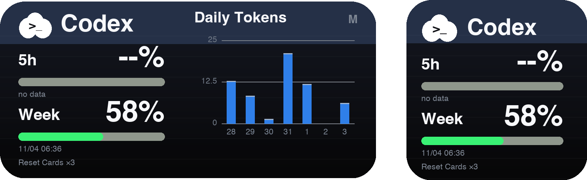

# Scriptable—script

clxiso 的 Scriptable 脚本集合。

## 脚本下载器

[下载脚本下载器.js](https://raw.githubusercontent.com/1clxiso/Scriptable-script/main/%E8%84%9A%E6%9C%AC%E4%B8%8B%E8%BD%BD%E5%99%A8.js)

首次需要手动安装下载器：打开上面的链接，复制代码，在 Scriptable 新建脚本并粘贴，命名为「脚本下载器」。也可以下载 `.js` 文件后导入。

之后运行下载器即可：

- 选择「安装 / 更新联通余量」，下载本仓库最新版。
- 选择「输入其他 raw 链接」，粘贴 HTTPS GitHub raw `.js` 链接，再确认保存名称。
- 已有同名脚本时会提示覆盖，并在本机 `Library/Scriptable下载器备份` 中按时间保存备份，每个脚本保留最近 5 份。更新代码不会清除 Keychain 中的 Cookie 和设置。

运行下载器选择「备份管理」，可查看备份时间和大小、预览代码、导出到「文件」、恢复版本、删除单份或清空全部备份。恢复前会备份当前版本，删除前需确认；兼容旧版 `.js.bak` 备份。备份只保存在本机，恢复目标是下载器所在目录。

脚本保存到下载器所在的 Scriptable 目录，支持本机和 iCloud。下载内容不会自动运行，下载器本身不提供定时自动更新。请在 Scriptable 内运行，不要设为桌面组件。

## 联通余量

显示话费余额、剩余通用流量与语音余量。支持小号、中号桌面组件，自动适配浅色和深色外观。

> 图片由脚本布局生成，使用示例数据，仅用于说明设计，不是 iPhone 实机截图。

### 下载和安装

[下载联通余量.js](https://raw.githubusercontent.com/1clxiso/Scriptable-script/main/%E8%81%94%E9%80%9A%E4%BD%99%E9%87%8F.js)

1. 将脚本导入 Scriptable，或新建脚本并粘贴代码，名称保持为 **联通余量**。
2. 在配套 Loon「中国联通去广告自用版」中开启「获取联通余量 Cookie」，打开已登录的联通 App 刷新首页。
3. 点击 Loon 的获取成功通知，在 Scriptable 中看到「导入成功」后，可关闭获取开关。
4. 桌面添加 Scriptable 小号或中号组件，选择「联通余量」，组件参数留空。

更新脚本时替换现有代码，保留脚本名称。凭据、组件设置和余量缓存保存在本机 Keychain，替换代码无需重新录入。

### 检查更新

直接运行「联通余量」，选择 **检查更新**。脚本从本仓库公开 raw 链接比较版本；发现新版后由用户确认，备份原代码再覆盖当前脚本，保留 Cookie、缓存、刷新设置和现有脚本名称。更新完成后重新运行即可。

旧版本中没有这个按钮，需要先通过「脚本下载器 → 安装 / 更新联通余量」更新一次。检查更新仅在用户点击时执行，不在桌面组件后台自动下载代码，也不会向 GitHub 发送联通 Cookie。若未发现新版则不会改写文件。

### 组件设置

直接运行脚本，可以选择小号或中号预览，以及 15、30、60、120 分钟刷新间隔。预览选择不会改变桌面上已有组件的尺寸，桌面尺寸需由用户自行选择。

间隔内复用缓存，手动预览或点击组件会立即查询。实际桌面刷新时间由 iOS 调度，设置的间隔不是精确定时保证。查询失败会显示缓存及原更新时间，Cookie 失效后需重新获取。

### 数据与隐私

脚本仅请求中国联通官方余量接口，不经过第三方中转服务器。凭据不写入此仓库，不打印到日志。本仓库不包含 Loon 私库配置、抓包或真实账号数据。请勿在 Issue 中上传 Cookie、导入通知链接或包含账号信息的抓包。

本脚本由 clxiso 维护；接口变化可能影响查询，欢迎提交不含个人信息的反馈。

## 油价小组件

显示所选省份的 92#、95#、98# 汽油和 0# 柴油价格，以及下次调价时间和网站提供的涨跌预测。建议使用中号桌面组件，支持浅色与深色外观。

> 图片依据脚本配色和布局绘制，价格、调价日期及预测均为示例数据，不是 iPhone 实机截图；实际显示以设备运行结果为准。

### 下载和安装

[下载具体油价显示 3.js](https://raw.githubusercontent.com/1clxiso/Scriptable-script/main/%E5%85%B7%E4%BD%93%E6%B2%B9%E4%BB%B7%E6%98%BE%E7%A4%BA%203.js) · [查看源码](./%E5%85%B7%E4%BD%93%E6%B2%B9%E4%BB%B7%E6%98%BE%E7%A4%BA%203.js)

1. 将脚本导入 Scriptable，或新建脚本并粘贴完整代码。
2. 在 Scriptable 内运行脚本，选择「配置省份」，输入省份简称（如「广东」「浙江」「北京」）及刷新间隔。
3. 返回后再次运行，选择「查看油价」，确认数据和组件显示正常。
4. 在 iPhone 桌面添加 Scriptable 中号组件，编辑组件并选择此脚本。使用已保存的省份时，组件参数留空。

如需在多个组件中显示不同省份，可在每个组件的 Parameter（参数）中分别填写省份简称，例如 `广东`。参数优先于本地配置；使用参数时，刷新间隔采用默认的 4 小时。

### 图标与刷新

- 中石化 Logo 已以 Base64 形式嵌入脚本，无需额外下载图片，也不依赖 GitHub 的图片连接。
- 刷新间隔默认 4 小时，可在「配置省份」中设置为正整数小时。
- 实际桌面刷新时间由 iOS 调度，设置的间隔不是精确定时保证。
- 油价数据仍需要联网；当前版本未缓存油价，油价请求失败时会显示错误提示。图标内嵌不代表整个组件可以离线获取数据。

### 调价时间如何获取

按以下顺序选择下次调价时间：

1. **网站公告**：读取 [汽油价格网](http://www.qiyoujiage.com/) 首页的「下次油价……调整」信息，成功后保存日期缓存。
2. **未过期缓存**：网站请求或解析失败时，使用仍有效的缓存，并标注「缓存」。
3. **本地日历**：没有有效缓存时使用脚本内置日期表，并标注「本地日历」。
4. **暂未获取**：以上来源均没有可用日期时显示「暂未获取」，不根据自然日推算调价日期。

所有调价时间均按北京时间解释。例如 `09/24 24:00` 等于 `09/25 00:00`；「今晚／明晚」按北京时间的日历日期判断，并附带具体月日。

网站日期没有年份时按当前年份解析，支持 12 月跨到次年 1 月。网站及缓存日期仅在尚未到期且距离当前不超过 45 天时采用。内置日历目前仅覆盖 **2026 年**：2027 年及以后仍可读取网站公告，但没有对应年份的离线日历兜底。网站更新延迟或页面结构变化可能影响结果。

涨跌预测来自网站，只有成功解析有效的在线调价日期时才尝试显示；无法获取预测时隐藏该行，不生成猜测值。

### 数据与本地存储

油价来自中石化查询接口；调价时间与预测来自汽油价格网公开网页，当前脚本通过 HTTP 读取该网页。使用本脚本无需填写账号或 Cookie。

省份和刷新设置保存在 Scriptable 本地文档目录的 `oilWidgetConfig.json`，调价日期缓存保存在 `oilWidgetAdjustmentCache.json`。更新脚本代码不会主动清除这些文件。

### 来源

脚本原作者署名为 **haoyu592**，本仓库版本加入了调价日期在线获取、北京时间显示修复和内嵌图标。Logo 原图来自 [haoyu592/DSbox](https://github.com/haoyu592/DSbox/blob/main/Old/Sinopec1.png)，脚本中保留了来源说明。

## Codex 用量

显示 Codex 的 5 小时窗口与周额度用量百分比、额度重置时间、最近 7 天每日 Token 柱状图，以及 Pro 计划附赠的重置卡剩余张数。

> 图片由脚本布局绘制，使用示例数据，仅用于说明设计，不是 iPhone 实机截图；左侧为中号组件（week 模式），右侧为小号组件。

### 下载和安装

[下载 Codex-Usage.js](https://raw.githubusercontent.com/1clxiso/Scriptable-script/main/Codex-Usage.js)

1. 此组件必须搭配自建用量接口使用，不接入任何公共服务。接口部署方法见 [MananaFX/Scritable-Codex-Usage](https://github.com/MananaFX/Scritable-Codex-Usage) 的说明，整体链路为：本地脚本定时请求 ChatGPT 用量接口并推送到 Cloudflare KV，Worker 从 KV 读取数据供小组件请求。
2. 将脚本导入 Scriptable，或新建脚本并粘贴代码，名称保持为 **Codex-Usage**。
3. 修改脚本顶部的 `DEFAULT_SERVER`，替换为自己的接口地址。
4. 桌面添加 Scriptable 组件，编辑组件参数：
   - `codex`（小号）：只显示 Codex 用量。
   - `claude`（小号）：只显示 Claude 用量（需接口配置了 Claude 数据源）。
   - `both`（中号）：左右分栏同时显示 Codex 与 Claude。
   - `week`（中号）：左侧 Codex 用量，右侧最近 7 天每日 Token 柱状图。

### 组件说明

- 组件内缓存上次数据，接口不可用时显示缓存并标注离线状态。
- 数据超过 10 分钟未更新时，组件会显示离线提示；本地推送脚本恢复运行后自动恢复。
- Pro 计划没有 5 小时窗口时，对应一栏显示 `--%`，重置卡行显示 `Reset Cards ×N`。

### 数据与隐私

仓库中的脚本不含任何个人服务器地址、令牌或 Cookie，`DEFAULT_SERVER` 为占位地址，需替换为自己的接口。用量数据（百分比、重置时间、每日 Token 数）保存在自己的 Cloudflare KV 中，不经过第三方展示服务。请勿将包含个人接口地址的版本公开发布，也不要在 Issue 中上传包含账号信息的数据。

### 来源

脚本改编自 [MananaFX/Scritable-Codex-Usage](https://github.com/MananaFX/Scritable-Codex-Usage)（作者 **MananaFX**），原项目提供 Scriptable 展示端代码与接口契约，本仓库版本加入了重置卡（Reset Cards）剩余张数显示，并默认适配自建 Cloudflare Worker + KV 数据链路。感谢原作者的设计，版权归原作者所有。

